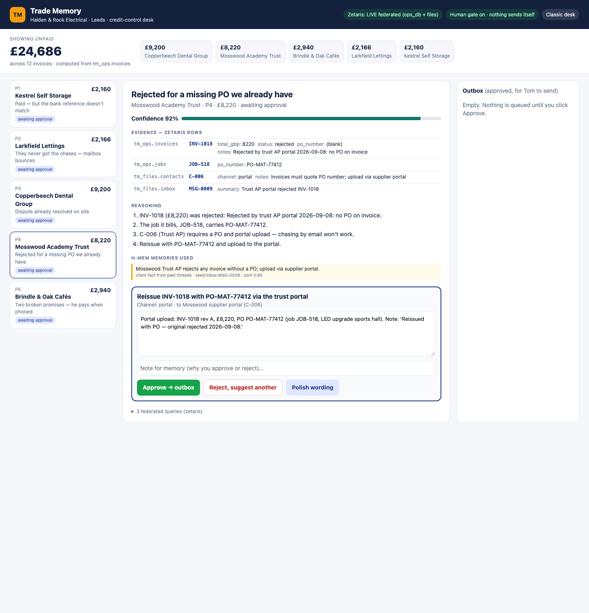
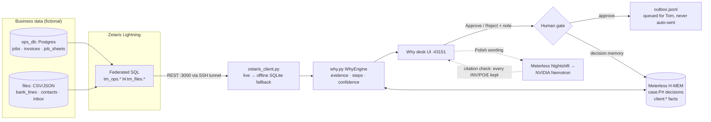

# Trade Memory

**A credit-control agent for small UK trade businesses that shows its working.**
Demo business: *Halden & Rook Electrical*, Leeds. This is a fictional company, and every client, person, address and email in `demo_data/` is made up.

Small contractors keep their money trail in four places: the job/invoice system, the bank feed, the CRM and WhatsApp/email. Trade Memory asks all four through **one federated SQL layer (Zetaris)**. Each next action comes as a **Why card** with its working. The card cites the exact rows, steps through the reasoning, gives a confidence score and lists the memories it used. **Nothing is sent until a person clicks Approve.** Every approval or rejection is stored in **H-MEM**, so the next proposal changes.

Open Agent Hackathon 2026. Track 02: Real-World Industry Agents.



## The five puzzles in the demo data

| # | Client | What a naive chaser would do | What the evidence shows | Card proposes |
|---|---|---|---|---|
| P1 | Kestrel Self Storage | Chase INV-1043 (£2,160) | Bank line BL-0078 came from the parent company KSS Ops, using its own reference (CRM C-010) | Allocate the receipt. Don't chase |
| P2 | Larkfield Lettings | Re-send to accounts@ | Three bounces (MSG-0002/4/6). AP has moved to finance@ (C-002) | Re-send INV-1007…1014 to finance@ |
| P3 | Copperbeech Dental | Chase £9,200 hard | Snag JS-216 is closed on site, and finance is waiting for sign-off | Send the snag sign-off and ask for the balance |
| P4 | Mosswood Academy Trust | Chase INV-1018 (£8,220) | Rejected for a missing PO. Job JOB-518 carries PO-MAT-77412 | Reissue with the PO through the portal |
| P5 | Brindle & Oak Cafés | Email again | Two broken promises (MSG-0011/12), and he pays when phoned | Phone today. If rejected → WhatsApp final notice |

£24,686 shows as unpaid in total, worked out from `tm_ops.invoices`. The cards explain why less than that is really owed.

## Architecture



- **Deterministic core.** Card facts, actions and confidence come from SQL rows and rules, never from an LLM. That keeps them reproducible and testable.
- **The LLM is optional and checked.** "Polish wording" rewrites a draft with Nemotron. The rewrite is thrown away if it drops or changes any invoice number, PO or £ amount.
- **Memory changes behaviour.** Approve moves the case to its next step. Reject switches to the alternative action, multiplies confidence by 0.9 and cites the rejection memory on the card.

## Sponsor tech

| Sponsor | Used for | Where |
|---|---|---|
| **Zetaris** | Federated SQL across Postgres (`tm_ops`) and file sources (`tm_files`). Every card shows the exact queries, row counts and timings | `trade_memory/zetaris_client.py`, `trade_memory/why.py` |
| **Meterless Nightshift** | OpenAI-compatible runtime, tried first for all LLM calls (with a fallback model lane) | `trade_memory/llm.py` |
| **Meterless H-MEM** | Layered memory with provenance: approval/rejection decisions per case, client facts citing their source rows | `trade_memory/hmem.py` |
| **NVIDIA Nemotron** | Draft wording and the classic desk's propose flow, served through Nightshift (Nebius Token Factory as fallback) | `trade_memory/llm.py`, `trade_memory/nebius_client.py` |

## Setup

```bash
git clone <this repo> && cd trade-memory
python3 -m venv .venv && source .venv/bin/activate
pip install -r requirements.txt
cp .env.example .env          # fill in locally; .env is gitignored
pytest -q                     # hermetic: dry-run LLM, temp H-MEM, offline Zetaris
uvicorn trade_memory.app:app --host 127.0.0.1 --port 43151
```

Open http://127.0.0.1:43151/ for the Why desk. The original desk is at `/classic`.

**Zetaris live mode.** The Zetaris server's API (:3000) and Thrift (:10000) listen only on its localhost. Reach them over SSH:

```bash
# .env: ZETARIS_SSH_HOST=<server>, ZETARIS_USER / ZETARIS_PASSWORD = Zetaris login
scripts/tunnel.sh install     # macOS launchd agent: starts at login, restarts if it drops
scripts/tunnel.sh status      # or: start | stop | uninstall
```

Without the tunnel or credentials, the client falls back to **offline mode**. It runs the same SQL against an in-memory SQLite copy of `demo_data/`, and the header says which mode is in use.

**LLM.** Set `NIGHTSHIFT_BASE_URL` / `NIGHTSHIFT_MODEL` (or `NEBIUS_*`). With neither set, the app runs in dry-run and every card still works.

## API

| Method | Path | Purpose |
|---|---|---|
| GET | `/api/why` | All five Why cards and outstanding totals |
| GET | `/api/why/{P1..P5}` | One card (evidence, reasoning, confidence, memories, queries, action) |
| POST | `/api/why/{pid}/decide` | `{decision: approve\|reject, action_id, note, draft_text}`. Returns 409 if the card has changed |
| POST | `/api/why/{pid}/polish` | Optional Nemotron rewrite of the draft, citation-checked |
| GET | `/api/outbox` | Approved items queued for a person to send |
| GET | `/api/health` | Status, dry-run flag, counts |
| … | `/api/recall`, `/api/propose`, `/api/decide`, `/api/digest`, `/api/followup` | Classic desk (v0.3) |

## Failure modes (honest)

| Mode | What happens | Mitigation |
|---|---|---|
| Zetaris unreachable | Tunnel down or no credentials | Offline SQLite copy runs the same SQL. Header shows "offline replica" |
| LLM invents or drops facts | A rewrite loses an invoice number or amount | Citation check keeps the rules draft. Facts never come from the LLM |
| Stale decision | A second tab approves an action that has already changed | `action_id` check returns 409 |
| Wrong proposal | The rules pick the wrong channel | Reject + note goes into H-MEM. The alternative action shows with lower confidence |
| Auto-send risk | An agent should not send money emails | No send path exists. Approve only writes to `data/outbox.jsonl` |

## Pre-existing components (declaration)

Trade Memory **v0.3.0** was built on 16–17 Sep 2026, before the Open Agent build window. It's committed as the baseline and tagged **`pre-window-v0.3.0`** (`0aad730`). That baseline covers the classic desk: the JSON memory store, recall, propose/decide, the digest and the cream/navy UI at `/classic`.

**Sanitised baseline.** Before publishing, the baseline commit was sanitised. Real client and person names were replaced with fictional ones, contact emails were anonymised and a private planning document was removed. Apart from that it's the same code as before the window: no features, logic or tests were added or changed. The tag was moved to the sanitised commit.

Everything after that tag was built inside the window. You can review the diff with `git diff pre-window-v0.3.0..HEAD`. It covers:
- fictional Halden & Rook demo data with the 5 puzzles
- the Zetaris client and federated queries
- the Nightshift-first LLM layer and H-MEM memory
- Why cards, the approval gate and the outbox
- the Why desk UI, the SSH tunnel and the tests

## License

MIT. See `LICENSE`.
